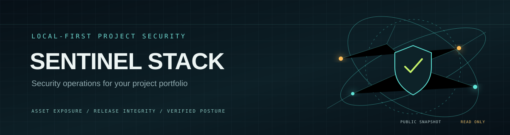
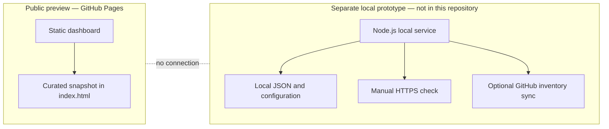

  

<h1 align="center">SENTINEL STACK</h1>

<strong>A local-first security operations console for understanding the health and exposure of your project portfolio.</strong>

  <a href="https://ayushkjha.github.io/Sentinel-stack/"><strong>OPEN THE LIVE DASHBOARD ↗</strong></a>

  
  
  

> **Scope today:** The live GitHub Pages dashboard is a static, read-only portfolio snapshot. It does not connect to GitHub APIs, scan or probe sites, monitor traffic, apply a firewall/WAF, enforce rate limits, or run AI. The fuller Node.js prototype and its local data are not included in this public preview repository. The sections below describe the exact boundary between implemented and planned capabilities.

## Contents

- [Mission](#mission)
- [How it works](#how-it-works)
- [What is included](#what-is-included)
- [Using the public dashboard](#using-the-public-dashboard)
- [Security model and limitations](#security-model-and-limitations)
- [Development roadmap](#development-roadmap)
- [Implementation guide](#implementation-guide)

## Mission

A growing portfolio can contain websites, mobile apps, APIs, and experiments, each with different owners, deployment paths, and security needs. Sentinel Stack is a project to make that portfolio easier to inspect from one security-focused control surface while keeping sensitive inventory and operational data local by default.

The current public build is deliberately a visual, read-only snapshot. It communicates the direction of the project without implying that protections or live monitoring are already running.

## How it works

The public page loads its curated portfolio rows from the static `preview-data.json` snapshot and its presentation from the bundled CSS and JavaScript files. The local prototype is a separate application that reads local data and exposes a loopback-only dashboard/API. Its manual HTTPS check runs only when requested; optional GitHub inventory sync requires a read-only token. No data path currently connects these two builds.

## What is included

| Capability | Current state | Notes |
|---|---|---|
| Cybersecurity dashboard interface | Available | Public, static GitHub Pages preview |
| Curated project inventory | Available | Snapshot content is maintained in the page source |
| Local project inventory and dashboard API | Prototype exists locally | Not included in this public preview repository |
| Manual HTTPS checks | Prototype exists locally | User-triggered; not continuous monitoring |
| GitHub repository sync | Prototype exists locally | Optional, read-only token; not connected to the public page |
| AI-assisted triage | Planned | No model or local AI runtime is connected |
| Firewall/WAF, intrusion detection, traffic or capacity monitoring | Not implemented | The dashboard is not an enforcement or monitoring layer |

## Using the public dashboard

1. Open the [live Sentinel Stack dashboard](https://ayushkjha.github.io/Sentinel-stack/).
2. Review the project list and its visible status indicators as a curated snapshot.
3. Follow a project link to inspect that project's own repository or deployment.

The page requires no account, token, install, or browser permission. Its status values do not update automatically and should not be used as evidence of a current security assessment.

## Security model and limitations

- The public build contains no access tokens, private repository inventory, local logs, or scanner output.
- Public dashboard content is not a security verdict; it is a presentation of a manually maintained snapshot.
- There is no automated probing, exploit testing, firewall configuration, incident response, alerting, or uptime SLA in this build.
- The local prototype is designed to bind to loopback and keep its operational files on the machine. It is not production-hardened for network exposure.
- Before connecting any provider, scanner, or model, the project needs explicit permission scopes, secret handling, audit trails, rate controls, and a reviewed threat model.

## Development roadmap

1. Package the local prototype as a reproducible, documented application with safe defaults.
2. Add explicit per-project enrollment and least-privilege, read-only repository discovery.
3. Add opt-in checks with clear rate limits, consent boundaries, and auditable results.
4. Add local alert triage only after the data sources and privacy controls are defined.
5. Validate deployment and recovery procedures before making any production protection claims.

## Implementation guide

The public GitHub Pages build contains only the static dashboard, its curated public portfolio snapshot, and the assets required to render it. The separate local Node.js prototype, local inventory, credentials and logs are not published here.

---

Built as a transparent starting point for safer, local-first project operations.

